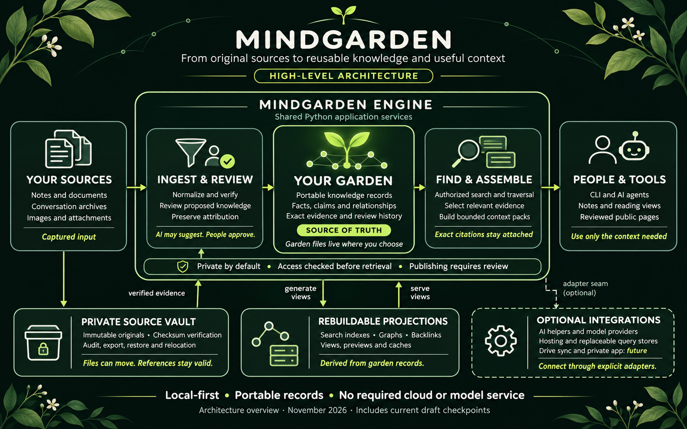

<p align="center">
  
</p>

# Mindgarden

🌱 A versioned knowledge garden and second-brain foundation for projects,
people, and organizations.

Mindgarden is the standalone source owner for the portable contract behind a
repository's `.garden/` directory. Obsidian vaults, agent context, search
indexes, and published sites are projections of that committed knowledge, not
competing sources of truth.

The local workflow includes the [overnight checkpoints](docs/overnight-sprint.md).
The merged [privacy/storage checkpoints](docs/privacy-storage-followthrough.md)
passed 515 tests on each supported Python. Captured conversations, bookmarks,
documents and opaque assets feed reviewed knowledge with exact source references.
Those references survive restore, relocation and clean projection rebuilds.
Optional extraction producers, authored learning, private compaction and local
federation remain bounded capabilities; the CLI needs no model or hosted database.

The [reading/evidence journey](docs/journey-sprint.md) adds reviewed private
reference repair, selected public-bundle context, actual static note reading and
a composed archive-to-context/recovery proof merged through #137. The same
synthetic proof matches from a clean checkout, installed wheel and unpacked source
archive; real private-pilot and publication acceptance remain separate.

The selected [local source-to-packet workflow](docs/local-consultation-workflow.md)
includes the merged [declared-ledger preparation packet](docs/consultation-packets.md):
exact decimal calculations, explicit overlap/transfer review, coverage gaps and
private evidence export. Its synthetic proof keeps exact citations through vault
recovery. The merged [selected Drive adapter](docs/drive-capture.md) adds bounded
read-only acquisition, explicit refresh and optional private OAuth setup. The
merged [scoped research CLI](docs/scoped-research.md) and packaged Codex profile
let an authorized caller use bounded existing read services. The
[private-pilot guide](docs/private-pilot.md) includes non-destructive preflight;
actual account/model proof and private execution remain unperformed.

The [active overnight roadmap](docs/overnight-sprint.md) reconciles completed
acceptance criteria and orders the next integration checkpoints. OpenAleph and
CozoDB evaluations recommend deferring service adoption; OpenViking native
acceptance remains incomplete. Proposed ADRs, release work, confidential runtime
assurance and real private-consumer pilots retain their explicit gates.

## System at a glance

<p align="center">
  
</p>

Read the [architecture overview](docs/architecture-overview.md) for a plain-language
guide, an editable diagram and links to current evidence. This image includes
implemented draft checkpoints; Drive sync and the private app are labelled future.
[ARCHITECTURE.md](ARCHITECTURE.md) and [SYSTEM.md](SYSTEM.md) remain authoritative
for boundaries and implementation state. The earlier
[product-vision illustration](docs/assets/mindgarden-architecture.png) is retained.

The optional [design source](design/README.md) captures this visual identity as
validated stack-neutral tokens, visual references and reusable prompt guidance.
`mindgarden design --format css` and `--format quartz` export derived views;
design tooling is optional for other contributors.

## Responsibilities

Mindgarden owns:

- the `.garden/` manifest and note metadata contracts;
- deterministic initialization, validation, indexing, and migration behavior;
- plain-Markdown knowledge lifecycle conventions;
- adapters for human, agent, and published views;
- provenance, confidence, review, visibility, and relationship semantics.

Mindgarden does not own:

- organization-wide agent policy or reusable intelligence contracts;
- development environment images;
- reusable CI/CD workflow implementation;
- organization-wide lint policy or repository propagation;
- Obsidian, Quartz, or another third-party tool's internal implementation.

Those boundaries allow the same committed knowledge to support an Obsidian
vault, a GitHub Pages garden, and multiple agent runtimes without creating
three competing stores.

## V1 contracts and local workflow

[`contracts/v1/`](contracts/v1/) defines the additive JSON Schema 2020-12
contract for gardens, captured and normalized sources, durable knowledge,
claims and evidence, typed synapses, ordered provenance, projections, and
migration history. It makes stable identity, privacy, review, classification,
routing scope, and publication authority explicit without treating folders or
a third-party application as canonical.

The v1 schemas are the target contract for the 1.0 roadmap. The 0.1 CLI now
creates deterministic v1 gardens and performs review-gated, rollback-safe
v0 → v1 migration while retaining the existing v0 agent and publishing
surface. The merged milestone stack adds general v1 validation and the bounded
private workflow below. Its architecture ADRs remain proposed. See the
[v1 contract model](docs/contracts-v1.md), [lifecycle command
contract](docs/initialization-migration.md), and [v0 → v1 compatibility
matrix](docs/v0-v1-compatibility.md).

The [private-garden checkpoint](docs/private-garden-evidence.md) initializes a
private garden, imports a synthetic conversation archive, applies an authored
human-reviewed prompt-bank proposal, searches exact evidence, builds bounded
context and relocates/restores a separate immutable source vault. The reference
workflow uses Python and local files; Google Drive, GitHub hosting, model services,
web interfaces and databases are optional integrations.

The [open-issue ledger](docs/open-issue-coverage.md) reconciles the merged
checkpoint with every remaining issue and its dependencies. Versioned public
descriptors/projections are merged through #66;
full consumer, publication and architecture acceptance remain separate.

The [public discovery checkpoint](docs/federation.md) adds reviewed, digest-bound
local exports and a catalog over explicitly supplied public bundles. It declares
remote fetching/querying/writing, private remote federation and signatures unavailable.
Run `python3 scripts/federation_demo.py --workspace ".cache/federation-demo"`
to reproduce the synthetic two-garden proof without integrations.

The new [private local discovery checkpoint](docs/local-federation.md) adds
metadata-first discovery and selected reads over the existing sessions, without
advertising private gardens in public catalogs. The [completion sprint ledger](docs/pipeline-completion-sprint.md)
records the review stack, source-adapter/archive work and [optional extraction proposals](docs/extraction-producers.md).
These are bounded implementation checkpoints; external owner and consumer gates remain open.

The [machine-local registry checkpoint](docs/local-registry.md), merged through
[#67](https://github.com/egohygiene/mindgarden/pull/67), adds reviewed registration,
named private selections, diagnosis, non-destructive unregister and configuration
recovery over existing local bindings. It changes machine-local control state;
canonical gardens and source vaults retain ownership. Run
`python3 scripts/registry_demo.py --workspace ".cache/registry-demo"` for the
synthetic Linux proof. Real consumer gardens are never configured by this demo.

```sh
python3 scripts/private_garden_demo.py --workspace ".cache/private-garden-demo"
```

Use Python 3.12 or 3.13 and a new or empty workspace. This command uses committed
synthetic fixtures with networking and external process calls blocked in-process;
it is not host isolation evidence. The [proof report](tests/fixtures/conversation-archives/expected-proof.json)
records exact source references and reproducible hashes. Real archives and
credentials stay outside this public repository.

The [v1 garden preview](docs/v1-site.md) connects reviewed public records to the
existing pinned Quartz adapter. `publish project` works offline; `site build`
uses a separately prepared offline renderer cache, and `site serve` provides a
loopback preview. The [six-checkpoint batch](docs/garden-experience-milestone.md)
records the merged preview, design, privacy, composition and contract checkpoints.
See the [merge receipt](docs/merged-experience-checkpoints.md) for the current baseline.

## Implemented v0 surface

The extracted v0 engine includes:

- [`contracts/garden.schema.json`](contracts/garden.schema.json) for
  `.garden/garden.yaml`;
- [`contracts/note.schema.json`](contracts/note.schema.json) for Markdown YAML
  frontmatter;
- [`contracts/obsidian-profile.schema.json`](contracts/obsidian-profile.schema.json)
  for portable, reviewable Obsidian integration metadata;
- [`contracts/provenance.schema.json`](contracts/provenance.schema.json) for
  source-to-artifact integrity records;
- [`contracts/context-pack.schema.json`](contracts/context-pack.schema.json)
  and [`contracts/index.schema.json`](contracts/index.schema.json) for
  deterministic agent projections;
- [`contracts/publish-profile.schema.json`](contracts/publish-profile.schema.json)
  for fail-closed static-site publication;
- the installable [`mindgarden`](src/mindgarden/) Python package and unified
  command for validation, ingestion, indexing, search, context, publication,
  and verification;
- explicit domain, application, adapter, and interface package boundaries;
- compatibility shims under [`scripts/`](scripts/) for the incubated 0.x
  command paths;
- [`templates/note.md`](templates/note.md) for new knowledge notes.

## Installation

Mindgarden supports Python 3.12 and 3.13. Before the first PyPI release, install
an immutable checkout or a reviewed local clone:

```bash
python3 -m pip install "/path/to/mindgarden"
mindgarden --version
```

PyPI publication is part of the final 1.0 release gate; no provisional package
is published by this change.

Point the installed command at a consumer repository:

```bash
mindgarden init --repository-root "/path/to/new-consumer" --visibility "private"
mindgarden migrate --repository-root "/path/to/v0-consumer" --plan
mindgarden validate --repository-root "/path/to/consumer"
```

The package has no runtime Python dependencies. Initialization, migration,
validation, indexing, search, and context generation remain offline. See
[`docs/cli.md`](docs/cli.md) for the full command, exit-code, library, and
compatibility contracts.

V1 retrieval also requires explicit local bindings and a query session created
with `mindgarden scope`; see [the retrieval commands](docs/v1-retrieval.md).
Existing v0 `verify`, `publish verify` and library calls retain their behavior.

The v0 parser deliberately supports only scalar values and scalar lists. This
keeps the foundational contract deterministic and dependency-free while the
larger authoring and indexing architecture matures.

## Provenance and extraction

The implementation graduated from Empathy with its relevant source history.
[`EXTRACTION.md`](EXTRACTION.md) records the immutable source revision and
extraction boundary; [`PROVENANCE.md`](PROVENANCE.md) records the commit map and
earlier design references.

No external project implementation is incorporated in this foundation pass.

The first consumer profile lives in [`profiles/obsidian/`](profiles/obsidian/).
It prefers native Obsidian capabilities and treats community plugins as explicit
human-approved options.

The portable agent surface lives in [`profiles/agent/`](profiles/agent/). Its
CLI is the dependency-free baseline; runtime-specific hooks and MCP servers may
wrap it later without changing canonical garden storage.

The public-site adapter lives in [`profiles/quartz/`](profiles/quartz/). It
filters canonical notes before an immutable Quartz checkout renders them, so
generator ignore rules are never treated as a privacy boundary.

See [`ROADMAP.md`](ROADMAP.md) for the path from this preserved v0 engine to the
first independently versioned release.

The [publication conformance pack](docs/publication-conformance.md) can test a
source or installed engine with synthetic fixtures and shareable diagnostics.

[Local portal composition](docs/portal-composition.md) preserves sibling surfaces
and emits an exact ownership receipt without deploying.

[Authored compaction and retention](docs/compaction-retention.md) adds a read-only
exact-evidence preview and synthetic curation handoff; originals are preserved.

## Product checkpoint status

The merged [broader product stack](docs/product-checkpoints.md) adds ADR metadata,
optional SQLite, dependency-build, reviewed memory and private bookmark workflows.
The [latest checkpoint qualification](docs/evidence/privacy-storage-qualification.json) passes 515
tests per supported Python, clean source/wheel recovery and actual browser checks.
Parent acceptance, historical ADR migration and the framework-dependent API/web
slice remain separate. Managed memory bundles, bounded due-card study, captured
bookmark cleanup and selected-output builds extend the existing services. The Python
CLI and dependency-free reference engine are preserved; no model or Google
integration is required. Release work is deferred.
