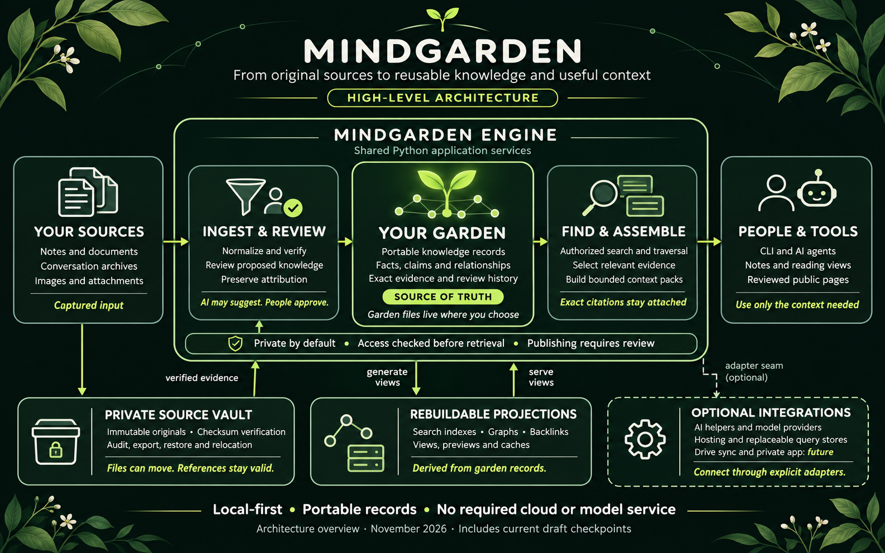
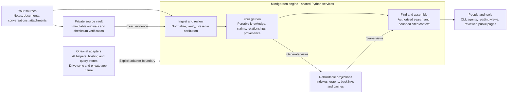

# Mindgarden architecture at a glance

Mindgarden turns supplied source material into portable, reviewed knowledge and
small, cited context packs that people and AI tools can reuse. The garden keeps
that knowledge across conversations and providers; original files and generated
views have separate storage and ownership boundaries.

This is a reading guide to [ARCHITECTURE.md](../ARCHITECTURE.md) and
[SYSTEM.md](../SYSTEM.md), not a new decision or replacement contract. It includes
the current foundation and the [draft reading/recovery checkpoints](journey-sprint.md).
Proposed ADRs remain proposed; a working implementation does not ratify them.

## Read the diagram from left to right

| Stage | What it means |
| --- | --- |
| Your sources | Notes, supported documents, conversation archives and supplied attachments enter through explicit capture/adapter contracts. Acquisition and normalization are separate responsibilities. |
| Ingest and review | The engine verifies and normalizes captured input. Authored proposals can summarize, connect or exclude candidate knowledge, but interpretation retains exact evidence and explicit review authority. An AI may suggest; its suggestion does not approve itself. |
| Your garden | Portable records own knowledge, claims, typed relationships, review and provenance. Each consumer owns its garden files and chooses their location. The garden can retain draft knowledge; downstream readers must respect its review state. |
| Find and assemble | Shared Python application services enforce authorization and review boundaries before selection, ranking or traversal. Explainable lexical search and graph relationships produce bounded Markdown/JSON context with source citations and represented revisions. |
| People and tools | The CLI and library expose the supported workflow. Agents can use its outputs, while Obsidian and reviewed public pages provide other views. A private application/API remains future integration work. |

The flow is a conceptual summary, not a requirement to use every component or
reimport unchanged sources for each question. Model calls are unnecessary for the
deterministic path. Basic metadata comes from the supplied source; meaningful
summaries and classifications need an authored interpretation, whether supplied
by a person or an optional model-assisted producer.

## The three boundaries underneath

**Private source vault.** Original archives and assets remain separate from
portable knowledge. Immutable content identities, checksums and evidence locators
preserve what was captured. Logical identity, represented content revision and
physical location are distinct; machine-local bindings resolve locations without
putting credentials or absolute storage paths into portable records. The tested
local workflow supports audit, export, restore, migration and relocation while
retaining originals. This does not claim encrypted or confidential-runtime
assurance for every provider or host.

**Rebuildable projections.** Indexes, graphs, backlinks, rendered views and caches
derive from canonical garden records. They can be rebuilt after relocation or a
clean checkout. A generated summary or view never silently becomes original
evidence. The optional SQLite baseline is a disposable query adapter, not the
owner of the garden.

**Optional integrations.** AI helpers, model providers, hosting and replaceable
query stores connect through explicit adapter boundaries. Automatic Drive
capture/sync and a polished private app are future features. A garden can live in
a chosen local/private repository while original sources live elsewhere; the
diagram does not mean this public software repository holds anyone's private
garden or that Drive integration is already available.

Private-by-default behavior spans the engine. Retrieval checks access before it
selects content; review and sensitivity restrictions follow derived outputs.
Public output requires explicit eligible review. A public catalog grants no
access to a private garden, and instructions found inside an archive remain
source data.

## Editable diagram

This Mermaid source preserves the high-level structure for text readers and
future edits. The PNG is an illustration of these boundaries, not an executable
contract or a source of permission.

## Implementation state and evidence

As observed on 2026-11-12, main `f5baa3d` contains the merged #127–#132
checkpoints. The diagram also includes these implemented, unmerged drafts:

| Draft | Bounded addition |
| --- | --- |
| [#133](https://github.com/egohygiene/mindgarden/pull/133) | Independently reviewed private incoming-reference repair, preserving historical edges. |
| [#134](https://github.com/egohygiene/mindgarden/pull/134) | Explicit supplied-public-bundle selection and bounded cited context under existing live authority. |
| [#135](https://github.com/egohygiene/mindgarden/pull/135) | Actual static note/search/backlink reading and native route/theme/ToC corrections. |
| [#136](https://github.com/egohygiene/mindgarden/pull/136) | A composed synthetic archive, review, exact retrieval, context and vault migration/relocation/restore/rebuild proof. |

The [journey ledger](journey-sprint.md) and
[artifact qualification](evidence/journey-artifact-qualification.json) preserve
commands, revisions, results and limitations. Full local/`act` qualification,
manual accessibility review, confidential-runtime assurance, the approved real
private pilot and consumer publication remain separate. This architecture
illustration is not acceptance evidence for the #21 insight-generation pipeline.

## Image provenance and maintenance

The founder requested this generated infographic on 2026-11-12. Its layout was
grounded in ARCHITECTURE.md, SYSTEM.md, the journey ledger and the existing
[visual reference](../design/references/mindgarden-visual-style.md),
[diagram guidance](../design/prompts/diagram-generation-style.md) and
[design tokens](../design/tokens/mindgarden.tokens.json). The asset contains only
public architecture labels, with no source archive or personal data.

The saved PNG is unchanged from the requested conversation image:
`sha256:1a146198322b456270c7c7b7be2908df518d5b1f1cfbb34bc33529b413fc2e9e`.
The earlier [product-vision illustration](assets/mindgarden-architecture.png) is
retained. Update the canonical architecture and status first, then this guide,
the Mermaid diagram and image as needed. Generated imagery does not own the
design tokens or architecture decisions.
