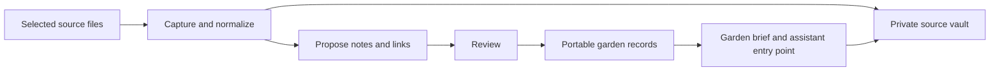

# Build a reviewed garden brief

A first sweep is a curation pass. Start with a small collection and choose
the observations worth keeping, their exact evidence, unresolved questions,
and useful links to existing notes. Willow Garden provides a fictional
example with reviewed career, studio, household and financial notes.

## Where the work belongs



| Step | Output |
| --- | --- |
| Capture and ingest | Immutable originals, normalized artifacts, hashes and exact evidence locators. |
| Curation | An evidence-bound proposal for a durable note, summary, claim, or link. The proposal can come from a reader or an assistant. |
| Review | The operator decides what to keep. Approved entries record their reviewer, uncertainty and provenance. |
| Build | Mindgarden projects the approved, authorized view into a compact brief and the existing versioned assistant entry point. |

During the first sweep, compare each proposed entry with the knowledge already
in the garden. Keep notes that answer a recurring question. Link them to the
sources and to the related notes the reader can actually use. Preserve
competing accounts and leave unsupported questions open. The
[existing gardenize plan](curation-plans.md) records the evidence references and
review decision. Capturing a file supplies evidence for the proposal.

## See the fictional result

From the `feature/reviewed-garden-brief` source checkout, use Python 3.12 or
3.13 and choose a new owned directory outside Git. On the earlier macOS setup,
the Homebrew interpreter is `"$(brew --prefix python@3.13)/bin/python3.13"`.

```bash
python3.13 -S scripts/garden_brief_demo.py --workspace "$HOME/mindgarden-brief-demo" --require-source
```

Open `GARDEN-BRIEF.md` for a reading map and `llms.txt` for the
`mindgarden.agent-entrypoint/v1` JSON ledger. The rehearsal rebuilds both
from the same reviewed records and verifies an exact citation through the
ordinary CLI. The [fictional sweep proposal](../examples/mock-garden/manual-sweep.md)
has exact line evidence for one new checklist and two proposed references.
Review is required before the candidate can contribute to the generated brief.

## Use a current authorized view

From an installed environment, pass explicit local bindings and the current
session.

```bash
mindgarden brief --local-config "/private/bindings.json" --scope "/private/session.json"
mindgarden brief --local-config "/private/bindings.json" --scope "/private/session.json" \
  --check "/private/GARDEN-BRIEF.md"
mindgarden llms --repository-root "/private/garden" \
  --local-config "/private/bindings.json" --scope "/private/session.json"
```

The brief is read-only and prints Markdown to stdout. Its selection fits the
session's result and byte limits. Typed relationships are included when the
session grants graph access and both endpoints fit. The heading and notes
describe only the authorized bounded view. Use an evidence-enabled session
to reopen the exact source references. The entry point lists stable records
and sources; a caller uses the existing scoped retrieval commands with an
explicit session and request budget. See [research](scoped-research.md) and
[reviewed retrieval](v1-retrieval.md).

Keep saved copies in their authorized workspace. `brief --check` rebuilds the
human view and compares the exact bytes. After a reviewed change, create a
fresh authorized session and rebuild. Revoked, expired, or revision-stale
authority fails before the projection returns bytes.

## How a future graph format would fit

The portable garden records and source vault own the reviewed entries and
original evidence. RDF models relationships. JSON-LD can serialize that RDF
graph, and PROV-O describes the lineage of source revisions, transformations,
and review activities. The brief can later point to the matching authorized
projection by represented revision. Its exact garden, record, and evidence
identities would come from the current contracts. A small, locally pinned
projection is the proposed evaluation in
[#91](https://github.com/egohygiene/mindgarden/issues/91). The Markdown brief and
current JSON ledger are usable on their own.

This is the fictional first-pass checkpoint for
[#162](https://github.com/egohygiene/mindgarden/issues/162). Model automation,
a live provider connection and the private Drive pilot have their own
roadmap checkpoints. [Roadmap #161](https://github.com/egohygiene/mindgarden/issues/161)
