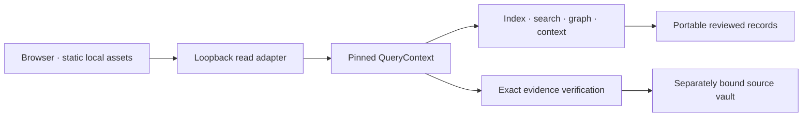

# Visit a local garden

Willow Garden is a fictional garden that runs in your browser from a local
Mindgarden process. It uses the same reviewed records, search and evidence
services as the CLI. It needs Python 3.12 or 3.13 and a browser.

## Start from a checkout

This checkpoint is on the `feature/local-garden-visit` branch. If you already
have that branch checked out, start at the last command.

```bash
git clone --branch feature/local-garden-visit https://github.com/egohygiene/mindgarden.git mindgarden-visit
cd mindgarden-visit
PYTHONPATH="$PWD/src" python3.13 -m mindgarden visit --demo --workspace "$HOME/mindgarden-demo"
```

Use `python3.12` instead if that is your installed interpreter. Open the full
link printed in the terminal. Leave the terminal running during the visit and
press Control-C to stop. Run the same command to return to the same workspace,
or select a new empty directory for a fresh copy. The default port is chosen
by the OS. An installed wheel or source package also supports
`mindgarden visit --demo --workspace "$HOME/mindgarden-demo"`.
On a Mac with Homebrew, `brew install python@3.13` provides the tested interpreter
if you need it.

### A two-minute tour

1. On Overview, open the career note or search for `accessibility`.
2. Open a source excerpt and look at the citation's revision, locator and
   checksum. The displayed excerpt is verified against that citation.
3. Follow the related Example Studio note. The conflicting delivery dates
   and the missing agreement are visible in its reading view.
4. Open Connections to follow the same links from the map or the linked list.
5. In Context pack, enter `consultation`. Download the bounded JSON to see
   which notes were selected and where each came from.

The demo has five reviewed fictional notes, four visible relationships and
fourteen citations. The consultation note is an example of a preparation
summary. Civics, Ethics and Akashic links open those public sites when clicked.
The garden runs after checkout with no Drive account or model service.

## Visit an explicitly scoped local garden

If a v1 garden already has [local bindings and a current session](v1-retrieval.md),
start the same read-only viewer with those files. The session must permit
`index`. The session's separate projection grants control what else is shown.

```bash
mindgarden visit --local-config "/path/to/bindings.json" --scope "/path/to/session.json"
```

The server binds IPv4 loopback. Keep the printed per-process access link
private. The browser removes the access fragment from the visible URL and
keeps the key in that tab's session storage so refresh can work. Requests
check the active session and the current garden revisions. Relaunch after
changing authority or the set of authorized revisions. The overview is capped
at 64 records and relationships, search at 20 results and a context pack at
five items and 16 KiB. Session budgets can lower those limits.
Close the tab and stop the process when done. Previously displayed text or a downloaded pack
remains on the machine, and browser history may contain search phrases and
note references. Keep downloaded packs within their authorized scope.

## Implementation and handoff



- `interfaces/cli.py` selects demo or explicit scope and starts the process.
- `interfaces/visit_demo.py` verifies the shipped ZIP inventory, writes the
  fictional garden and vault once in an owner-only workspace and generates
  machine-local bindings. It uses an atomic staging rename.
- `interfaces/local_web.py` exposes allowlisted read routes. It requires
  loopback Host, same-origin checks, a per-process capability and the approved
  session. Responses use no-store and return opaque errors for denied records.
- `interfaces/web/` contains the local assets and browser code. The note view
  treats excerpts as text, refreshes authorized metadata on navigation and
  offers a linked list alongside the graph. The browser has no runtime CDN
  dependency. The original cover illustration ships as a WebP.
- `application/query.py`, `retrieval.py` and `evidence.py` own authorization,
  ranking, output bounds and evidence integrity. The browser uses these
  services and creates no durable garden records.

The demo archive is a derived, synthetic test fixture. To reproduce its
bytes from the authored seeds and restore workflow:

```bash
python3.13 -S scripts/mock_garden_demo.py \
  --workspace "/path/to/new-private-qualification-workspace" \
  --require-source --check-golden \
  --visit-fixture "/path/to/new-visit.zip"
cmp "/path/to/new-visit.zip" examples/mock-garden/visit.zip
```

Use the focused offline boundary checks and optional browser smoke:

```bash
PYTHONPATH=src python3.13 -m unittest tests.test_local_web tests.test_mock_garden -v
python3.13 scripts/check_local_visit_browser.py --chromium "/path/to/chromium" --axe "/path/to/axe.min.js"
```

The smoke requires Playwright in the test interpreter. You can omit `--axe`
for the interaction checks alone. `--screenshots` saves fictional previews
at desktop and mobile sizes.

The viewer is a bounded local checkpoint for [#17](https://github.com/egohygiene/mindgarden/issues/17)
and [#47](https://github.com/egohygiene/mindgarden/issues/47). Public Quartz
publication, authenticated sharing, ingestion and review from the browser,
worker recovery, manual assistive-technology testing and the owner's
first real private pilot retain their existing acceptance gates. The storage
and runtime decisions retain their current ADR dispositions. To extend the
viewer, add an authorized application-service operation first, exercise
denials and bounds, then add browser presentation.
