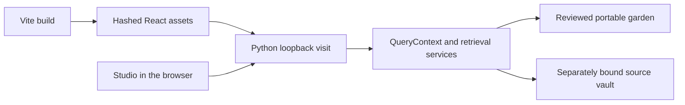

# Mindgarden Studio

Studio is the React browser interface for a locally authorized Mindgarden
session. Willow Garden provides five reviewed fictional notes, a relationship
map, evidence excerpts, and a context-pack walkthrough. The existing
[Python-only visit](local-garden-visit.md) remains available on the same engine.

## Start Studio

Use Node 24 and Python 3.12 or 3.13. From a clean checkout:

```bash
git clone --branch feature/studio-knowledge-explorer https://github.com/egohygiene/mindgarden.git mindgarden-explorer
cd mindgarden-explorer
npm --prefix web ci
npm --prefix web run build
PYTHONPATH="$PWD/src" python3.13 -m mindgarden visit --interface studio --demo --workspace "$HOME/mindgarden-demo"
```

Open the full link from the terminal. Run the final command again to return
to the same workspace. Choose another empty directory to start a fresh
demo. After building, only Python and a browser are needed to run Studio.
The app and its fonts load locally. Vite leaves the shared cover URL for
Python to serve, so its build can report that the cover resolves at runtime.
On macOS, `brew install node@24 python@3.13` can install the two tools. If
Node 24 is not on your path, run `export PATH="$(brew --prefix node@24)/bin:$PATH"`.

The dashboard links to Civics, Ethics and Akashic. These are outbound links
to their public sites. The garden uses the bundled fictional files for the
demo and can open an existing explicitly authorized v1 session.

```bash
mindgarden visit --interface studio --local-config "/path/to/bindings.json" --scope "/path/to/session.json"
```

Installed wheels can serve Studio when it was built before packaging. A
missing build gives the build commands and exits before initializing a
workspace. For a development cycle, rebuild and restart the Python visit
so the server pins the new hashed asset manifest.

## Take the tour

1. On the dashboard, browse the **Library** or press **Command-K** on Mac
   or **Control-K** elsewhere. Search for `accessibility` and expand the
   matching explanation.
2. Open the career note and one exact source excerpt. Follow the related
   Example Studio note to see the two disputed delivery dates.
3. Select **Find on map** in the note reader. Follow the related studio
   note in the map's inspector. Use the trail to return to an earlier
   focus, or use **Full map** to reset. Search the map or pick a topic,
   and select **Explore in 3D** to orbit the same scoped graph.
4. Open **Sources** to see Google Drive and the local source vault. The
   demo's Drive card identifies its fictional capture. Citation totals
   are distinct citations within the visible, bounded review view.
5. Open **Context packs** and search for `consultation`. Download the JSON
   to see the citations, selection reasons, and byte budget.

The optional [fictional assistant pilot](studio-assistant-pilot.md) adds chat,
context review, and a monthly booklet to the fictional Studio visit.
The optional [Models pilot](studio-model-connections.md) adds provider
checks, per-request model selection, a fictional comparison prompt, and
reviewed Ollama downloads.

## Show reviewed Drive evidence

A local session can show **Captured evidence** for a Drive snapshot.
Mindgarden compares each visible citation's normalized source with the
matching captured unit in the bound vault. The Sources view requires the
session's evidence grant and returns aggregate counts. It keeps capture
paths, provider identities and OAuth files in the local workspace.

Set up the [local Drive capture](drive-capture.md) with its own desktop
OAuth consent and an explicitly selected folder. Review the capture plan,
apply its digest with network permission, import the frozen snapshot,
and review the derived notes. Start Studio with their scope and bindings.
The source card describes that reviewed snapshot. The ChatGPT Drive
connector has separate credentials, and the card performs no background
provider requests.

## Architecture and ownership



- `web/src/Studio.tsx` owns navigation, the dashboard and the keyboard
  search dialog. React and TypeScript organize the interface. Tailwind and
  CSS define styling, and Motion handles view transitions.
- `web/src/features.tsx` uses TanStack Query for active read views.
  The query client holds results in memory with no persistent cache.
  Search terms and note selection stay out of the browser's URL. The
  application revalidates authority through Python on route changes.
- `web/src/api.ts` validates the Python response shapes with Zod, keeps
  the access capability per tab, and preserves the exact bytes of a
  bounded context pack. The existing Python services still verify scope,
  record revision, and source integrity.
- `web/src/explorer.tsx` navigates authorized graph results through
  text and topic filters, a focused neighborhood, and a trail. Its
  selected references remain in memory.
- `web/src/graph.tsx` presents authorized connections with a keyboard
  accessible map and a text list. `graph-scene.tsx` uses React Three
  Fiber and Three.js in a lazy chunk. It falls back to 2D when WebGL is
  unavailable or loses its context.
- `interfaces/local_web.py` serves the selected interface on IPv4
  loopback. It allowlists the compiled Studio manifest and uses the
  same Host, Origin, per-process access and no-store boundaries as the
  classic visit. The app exposes a scoped connector summary with the
  existing evidence grant. `application/connector_evidence.py` verifies
  available immutable capture lineage and returns count-only status.
  The generated Vite license inventory is included in a
  built package for review. Previously displayed text and downloaded files remain
  subject to the user's local handling.

The two pinned npm packages can be built independently. This checkpoint
uses package scripts for task execution. Nx can be assessed when multiple
production apps need a shared dependency graph and build cache.

## Try Next.js separately

The [Next.js rendering lab](../experiments/next-rendering/README.md) is an
optional App Router experiment with the same fictional world. Its static
page is rendered during the build and its request-time page is rendered
when it is opened. The filter on both pages is a client component. Start
the lab in a second terminal:

```bash
npm --prefix experiments/next-rendering ci
npm --prefix experiments/next-rendering run build
npm --prefix experiments/next-rendering run start
```

Open `http://127.0.0.1:4175` and compare **Request again** on the two
pages. The lab reads the checked-in fictional seed. Studio's launch and
private-session binding use the Python visit.

## Verify and extend

```bash
npm --prefix web ci
npm --prefix web run build
npm --prefix web test
PYTHONPATH=src python3.13 -m unittest tests.test_local_web tests.test_mock_garden -q
python3.13 scripts/check_studio_browser.py --chromium "/path/to/chromium" --axe "/path/to/axe.min.js"
```

The browser check uses Playwright in the test interpreter. `--webgl`
exercises the 3D map with Chromium's software WebGL. The default checks
the 2D fallback. Use `--screenshots` for fictional preview captures.
For an operation that changes records, establish and review its
application-service contract, validation and authority before adding a
browser entry point.

This is a draft checkpoint under [#47](https://github.com/egohygiene/mindgarden/issues/47)
and [#17](https://github.com/egohygiene/mindgarden/issues/17). The broader
browser editing, hosted identity, manual accessibility, private consumer
and publication criteria remain open. Runtime and identity ADRs retain
their proposed status.
