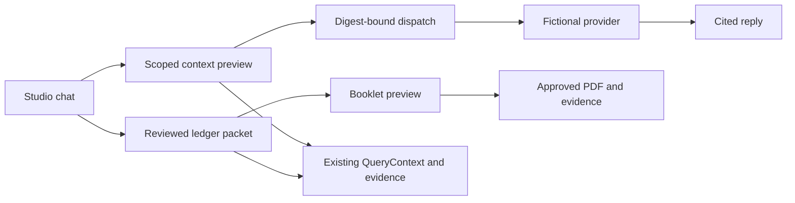

# Try the local Studio assistant pilot

The pilot connects one reviewed garden view to a context preview, a
fictional assistant reply, and a cited January 2026 finance booklet.
Use Willow Garden from the draft checkout to rehearse the flow before
selecting real sources. [Workflow #161](https://github.com/egohygiene/mindgarden/issues/161)

## Start the fictional pilot

From a clean checkout of `feature/scoped-studio-assistant-pilot`, use
Node 24 for the build and Python 3.12 or 3.13 for the visit.

```bash
npm --prefix web ci
npm --prefix web run build
PYTHONPATH="$PWD/src" python3.13 -m mindgarden visit \
  --interface studio --demo --assistant fixture \
  --workspace "$HOME/mindgarden-assistant-demo"
```

On the earlier Homebrew setup, use
`"$(brew --prefix python@3.13)/bin/python3.13"` for the interpreter if
`python3.13` is outside your PATH. Open the full terminal link. Keep the
same workspace for another visit or choose a new empty private directory.

## Take the tour

1. Open **Chat** in Studio or start from a reviewed note. On the garden
   lens, ask about accessibility. Review the selected note text and
   exact citations before running the fictional reply.
2. Open a citation in the existing note reader. Return to **Chat**,
   choose the **Finance** lens, and select **Entire permitted garden**
   to leave the career note. Ask what the spending notes say about
   monthly finances. Review the context and run the fictional reply,
   then choose **Open consultation booklet**.
3. Preview the January 2026 fictional packet. Check the reviewed period,
   supplied and missing accounts, totals by currency, unresolved items
   and citations. Approve the preview to download the PDF and its
   evidence manifest.

The assistant is fictional and runs offline. This visit uses the same
reviewed source boundaries as search and context, plus the existing
ledger and packet services for the booklet. Launching the ordinary
Studio visit keeps its existing graph, library, Sources and context
features.

## Authority and ownership



- Studio keeps chat state in the tab. The local broker rechecks its
  pinned session, evidence, context limits and approval digest before
  sending the prepared input to the fixture. The browser can stop the
  stream.
- The local visit uses its existing per-launch capability. Assistant
  and booklet calls use small JSON POSTs with the exact loopback
  origin. Prompt content stays in the request body. Replies and
  downloads inherit the session boundary.
- The fixture sends text and citations from the approved context. It
  reports gaps and qualifications. The UI treats its text as data.
- The booklet uses the verified January ledger result in the bundled
  fictional fixture. It requires an approved current preview digest
  for both downloads. The renderer uses the existing exact
  calculations and the approved inputs. It performs no automatic
  sharing.
- Fictional assistant mode uses a separately pinned source grant for
  the exact booklet inputs. The ordinary demo scope and other users'
  local scopes remain independently configured.

## Move from the rehearsal to the real pilot

Select one folder and complete the existing owner-side capture and
review. Studio can show **Captured evidence** for only the reviewed
snapshot available to the session. [Drive #87](https://github.com/egohygiene/mindgarden/issues/87)

The first signed-in Codex turn has its own provider qualification.
Sign-in, allowed disclosure, and isolated runtime proof belong to that
checkpoint. See the [local Codex protocol guide](studio-codex.md).
[#163](https://github.com/egohygiene/mindgarden/issues/163)

The fictional chat and booklet advance #164 and #165. Real provider
execution, a private user-selected month, and broader application
editing remain separate acceptance. A second live provider follows
qualification of the first Codex workflow. [#166](https://github.com/egohygiene/mindgarden/issues/166)
